<style>
  img[alt~="center"] {
    display: block;
    margin: 0 auto;
  }
</style>

<style>
.small-center {
  font-size: 0.7em;
  text-align: center;
}
</style>

<style>
.large-center {
  font-size: 2em;
  text-align: center;
}
</style>

<!-- Intro Slide -->
<!-- _paginate: skip -->

# The 80/20 of ML Monitoring

##### Pietro Mascolo

###### Dublin, 2026-11-21

&nbsp;
&nbsp;
&nbsp;
&nbsp;


> What Actually Matters in ML Systems
> http://bit.ly/4dfU5lf


<!-- Welcome and set the tone: this talk is not “intro to dashboards.” We’re going to cover the small number of things that actually matter in real ML monitoring. Emphasize that monitoring is not MLOps fluff — it's core to responsible modeling. -->

---

## What We’ll Cover

- Why monitoring
- Failure signals
- A lean and robust monitoring architecture
- Python-first tools
- Deep dive: drift, skew, freshness, quality, degradation
- Common pitfalls

<!-- Frame the narrative: the goal is clarity and discipline. We will focus on what is universal across orgs, not on vendor-specific solutions. -->

---

# A word about me

👤 Pietro
🇧🇷 🇮🇹 🇮🇪 🇮🇳
👪 Husband and dad.
💼 Pragmatic Data Scientist.
💻 Passionate about applied AI, Python, Go, and many nerdy things.
🥋 📷 📻 🥾🏍️
📫 `@iz4vve`

---

## The traditional approach:

- log predictions
- build pretty dashboards (that no one will ever use fully)
- look at some hastily drawn KPIs (sometimes)
- pray nothing breaks

<!-- But real systems fail due to distributional instability, not exceptions. -->

<!-- Explain the empirical reality: the majority of ML production failures come from data issues and unnoticed drift. Most teams dramatically overestimate what dashboards catch and underestimate pipeline rot. Set expectation: this talk prioritizes conceptual rigor over tooling worship. -->

---

# The real world

* if it can go wrong, it will.
* If it can't go wrong, it will anyway.

---

<!-- 
Traditional monitoring works under some very stringent assumptions that rarely hold true in today's world. -->


---

## Stable requirements
<!-- 
We expect that the odel owners really understand their requirements and needs and that those are set in stone. -->


---

## Deterministic logic

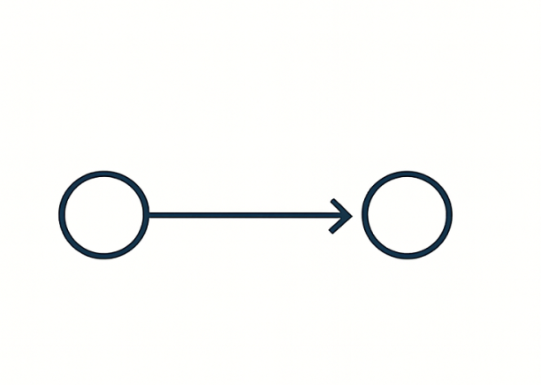

<!-- We expect simple logic that can lead to building rules and linear understanding.
This is especially untrue if you deal with non-deterministic domains, like people behaviour.
 -->

---

## Static invariants


<!-- 
We expect the world to stay largely the same, only very slow changes over time and no abrupt variations in behaviour or boundary conditions. -->

---

# The real world...
<!-- 
These expectations are, of course, not much more than wishful thinking. The real world is messy at best, chaotic at worst. -->

---

## Stochastic spaces


---

## Shifting distributions

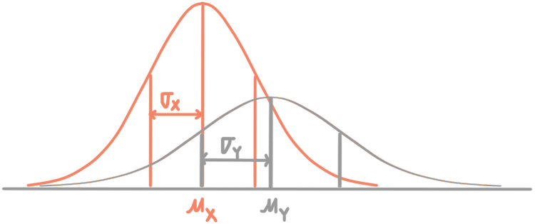

---

## Unclear objectives


<!-- Example: fraud models degrade because fraudsters adapt, not because code breaks. Monitoring ML is not about uptime — it’s about epistemic uncertainty. -->

---

## It’s rarely the model...

* data pipeline schema drift
* training-serving mismatch
* feature staleness
* fundamental concept drift
* corrupted ingestion
* misaligned evaluation
* feedback loop instability

<!-- The usual suspects when it comes to failure include human error: data pipelines are wrong, incomplete, or out of sync, features evolve and wedon't keep pace, things change, data quality issues, ... -->

---

## You need a plan

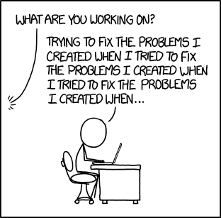

<p class="small-center">Source: https://xkcd.com/1739/</p>

<!-- 
If you don't want to generate an even bigger mess, you need to plan before you start doing anything. You don't want to be the one that generates the new spaghetti-ML-monitoring paradigm.
Lean into the “data-centric” message: Monitoring models is downstream — catching issues after impact. Monitoring data lets you catch issues before predictions degrade. -->

---

# Where to focus?

&nbsp;
&nbsp;
&nbsp;
&nbsp;
&nbsp;
&nbsp;
&nbsp;
&nbsp;
&nbsp;
&nbsp;


---

## The 80/20 signals

&nbsp;

* Data Drift
* Training–Serving Skew
* Feature Staleness
* Performance Degradation
* Data Quality / Pipeline Breakage

---

# 1. Data Drift

&nbsp;
&nbsp;
&nbsp;
&nbsp;
&nbsp;
&nbsp;
&nbsp;
&nbsp;
&nbsp;
&nbsp;
&nbsp;
&nbsp;

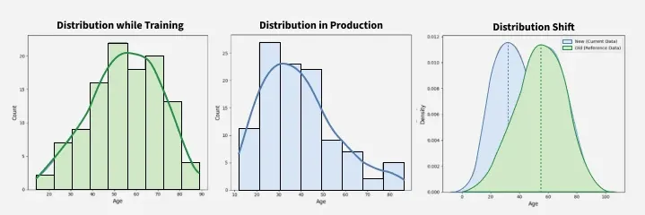

<!-- ---

## Data drift

&nbsp;

###### Distribution shift between training and production inputs.

&nbsp;

Why it matters:
Even small shifts can have multiplicative downstream effects. -->

---

## 1. Data Drift: concept drift

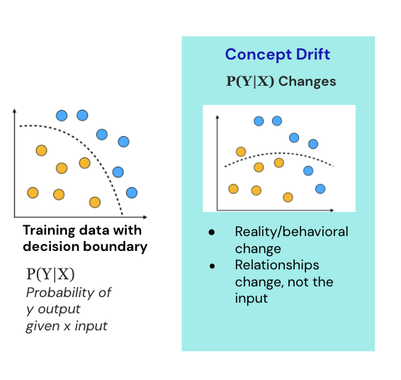

<!-- P(Y|X) changes. your posterior is not the same. 
It's the relationship between the covariates that 
changes.

Example: fraudsters change type of fraud pattern: instead of large sums at odd hours of the day they ove to small multiple transactions regardless of the hour.
-->
---

## 1. Data Drift: feature/label drift

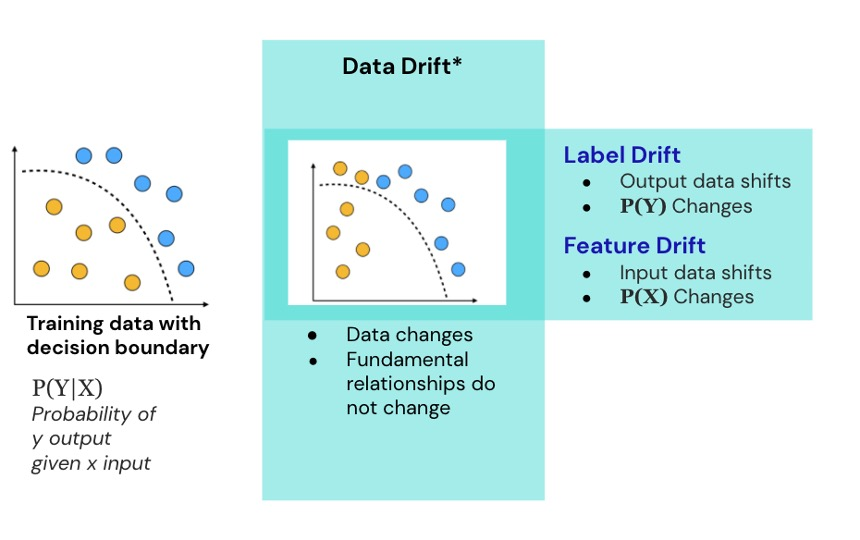

<!-- P(X) or P(Y) changes.  One of the covariates changes. 

Example in fraud detection: same types of fraudolent behaviour, but all of a sudden contactless payment frequency goes up by 5%
-->
---

## 1. Data Drift: how it can appear

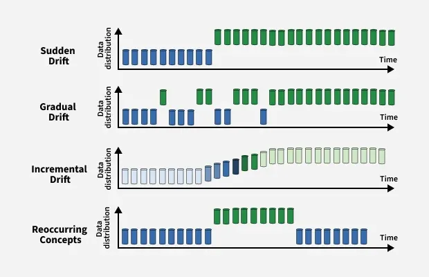

<!-- 
Drift can present itself in many different ways:

KL divergence, PSI, KS test
Embedding drift (advanced)
Statistical consistency checks

Highlight the limitations of simple metrics like PSI, and suggest monitoring multiple drift signals. Advanced teams use representation models for multimodal or high-dimensional drift detection. -->

---

## Drift Check (Evidently)

```python
from evidently.report import Report
from evidently.metric_preset import DataDriftPreset

report = Report(metrics=[DataDriftPreset()])
report.run(reference_data=train_df, current_data=prod_df)
results = report.as_dict()
```

---
## Drift Check - Evidently report

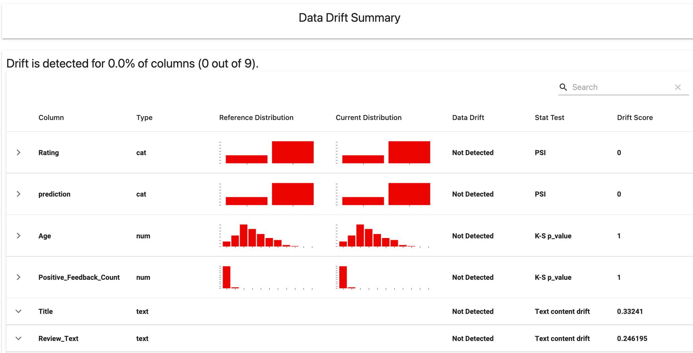

---

# 2. Training–Serving Skew


---

<style scoped>
h2 {
  color: white;
}
</style>

## Often a design issue...

&nbsp;
&nbsp;
&nbsp;
&nbsp;
&nbsp;
&nbsp;
&nbsp;
&nbsp;
&nbsp;


---

## Training–Serving Skew

### Symptoms

- Model behaves well offline → terrible in production
- Predictions drift or suddenly degrade
- Debugging harder than it should be

---

## Training–Serving Skew

### Causes

- Different preprocessing between training & inference
- Feature drift over time
- Silent schema changes
- Code inconsistencies


<!-- Speaker Notes
the model saw one world during training and a different one during inference. Juniors often miss that preprocessing mismatch is responsible for most “my model sucks in prod” complaints. Emphasize that alignment is a systems problem, not a modeling problem.

Make both environments deterministic and aligned.
 -->

---

## Training–Serving Skew: Concrete Example
Training preprocessing (Python)

```python
# training_step.py

df["income_log"] = np.log(df["income"] + 1)
df["age_bucket"] = (df["age"] // 10) * 10
df = df.fillna(df.mean(numeric_only=True))
```

Serving preprocessing (FastAPI endpoint)

```python
# inference.py

income_log = math.log(user.income) # missing +1 handling
age_bucket = round(user.age / 10) * 10 # different logic
income = user.income if user.income else 0
```
<!-- 
Make sure your logic and code are the same across environments (ideally even use the same module) -->

---

## Training-Serving Skew: practical strategy
Shared data transformation module

```python
# features.py
import numpy as np

TRAIN_MEAN = ...

def income_log(income: float) -> float:
    return np.log(income + 1)

def age_bucket(age: float) -> int:
    return (age // 10) * 10

def impute(value):
    return value or TRAIN _MEAN
```

<!-- ---

```python
# test_features.py

from hypothesis import given, strategies as st

@given(st.floats(min_value=0, max_value=1e6))
def test_income_log_properties(x):
    y = income_log(x)

    # invariants
    assert y >= 0
    assert isinstance(y, float)
    assert income_log(x + 1) >= y  # monotonicity
``` -->

<!-- Test for results and properties using randomised tests as well as deterministic ones. Find and deal with edge cases. -->

---

## Pipeline consistency check

```python
# gross oversimplification

def hash_pipeline(funcs):
    import hashlib
    return hashlib.sha256(
        "".join(f.name for f in funcs).encode()
    ).hexdigest()

assert train_pipeline_hash == serving_pipeline_hash
```
---


## Skew Prevention Checklist (Use Before Every Release)

* Same transformations in training & serving?
* Same categorical mappings?
* Same feature defaults and missing-value rules?
* Same data types? (int vs float is a real bug)
* Same ordering? (sorted vs unsorted lists break embeddings)
* Contract tests passing?
* Synthetic tests run on both pipelines?
* Shared module regenerated after spec changes?

---

## 3. Feature Staleness

---

## What you get when Data gets old...

&nbsp;
&nbsp;
&nbsp;
&nbsp;
&nbsp;
&nbsp;
&nbsp;
&nbsp;
&nbsp;
&nbsp;


<!-- Happens when your Data gets old... -->

---

## Feature staleness: what causes it

Input signals stop reflecting current reality,  while the model assumes they are ok.

Common causes (unrelated to data drift):

- delayed batch jobs
- broken upstream pipelines
- cached feature stores
- API data lag
- silent ingestion failures

<!-- ---

## Feature Staleness: Practical Detection

Rule-based freshness check

```python
from datetime import datetime, timedelta

def is_stale(feature_timestamp, max_age_hours=6):
    return datetime.utcnow() - feature_timestamp > timedelta(hours=max_age_hours)
```

Batch check over dataset

```python
stale_features = df[df["timestamp"] < cutoff_time]
stale_ratio = len(stale_features) / len(df)

# trigger
if stale_ratio > 0.1:
    raise Warning("Feature freshness degraded")
``` -->

<!-- Simplistic check: what matters is ensuring the data you are using is recent enough for your purposes. -->

---

<style scoped>
h1 {
  color: #362f87;
}
</style>

# 4. Performance Degradation

&nbsp;
&nbsp;
&nbsp;
&nbsp;
&nbsp;
&nbsp;
&nbsp;
&nbsp;
&nbsp;
&nbsp;
&nbsp;
&nbsp;
&nbsp;
&nbsp;
&nbsp;


---

## Model performance is the lagging indicator of system health

Causes:

- real-world behavior shift
- upstream feature corruption
- label distribution changes
- seasonal effects
- direct evaluation may be impossible
- proxies may misrepresent ground truth
- multi-objective systems degrade unevenly

<!-- By the time performance drops, the root cause already happened upstream. -->

---

## Performance Monitoring

Offline evaluation (baseline)

```python
from sklearn.metrics import roc_auc_score

auc = roc_auc_score(y_true, y_pred)
```

Production evaluation (delayed labels)

```python
def compute_live_auc(preds, labels):
    return roc_auc_score(labels, preds)
```

Rolling degradation tracking

```python
if current_auc < baseline_auc - 0.05:
    alert("Performance degradation detected")
```

<!-- Monitor performance over time consistently. Do not just chewck every few months. -->

---

## 5. Data Quality & Pipeline Integrity

&nbsp;
&nbsp;
&nbsp;
&nbsp;
&nbsp;
&nbsp;
&nbsp;
&nbsp;
&nbsp;
&nbsp;
&nbsp;
&nbsp;
&nbsp;

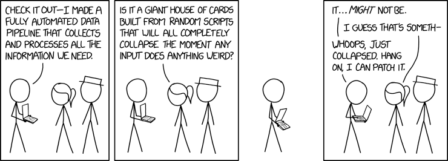

<p class="small-center">Source: https://xkcd.com/2054/</p>

<!-- Don't just put together things with scotch tape and hopes. Make sure your architecture is well thought out, tested, documented, and robust. -->

---

## Typical issues

* missing columns
* schema drift
* invalid ranges
* corrupted rows
* duplicated data
* type mismatches

If data is wrong, model evaluation is meaningless.


---

## Data quality

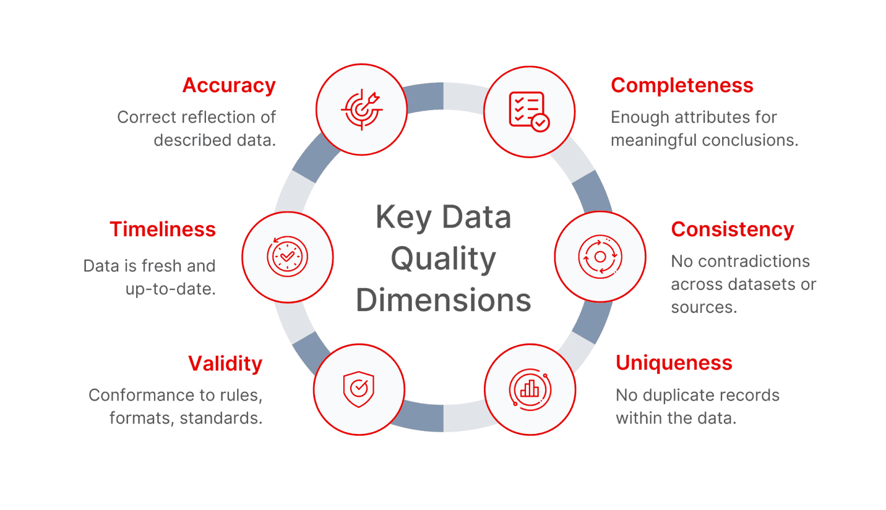

<!-- Ensure data quality checks are run at any point in which something might fail. Check along mkultiple dimensions: wrong data doesn't always look wrong... -->

---

## Data validation

```python
import pandera as pa

schema = pa.DataFrameSchema({
    "age": pa.Column(int, checks=pa.Check.in_range(0, 120)),
    "income": pa.Column(float, nullable=True),
    "user_id": pa.Column(str),
})


# Validation step
schema.validate(df)
```


<!-- data quality issues often masquerade as “model issues” but are unrelated 

 power comes from simplicity and control. Large MLOps platforms often obscure what’s going on — bad for debugging.
 
 Alternative tools: great expectations -->

---

## Flow

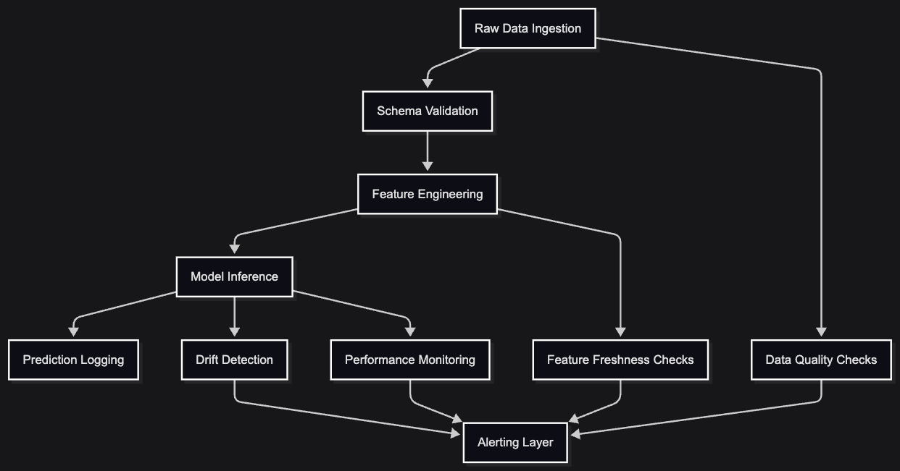
<!-- 
Flow of checks and monitoring. Checks for DQ can be at ANY stage (and ideally, every one). -->

---

# Principles of Effective ML Monitoring

---

## Key principles

Good:

- detect early
- stay simple
- focus on signals, not dashboards
- cheap to run
- easy to reason about
- have a clear baseline for **everything**

---

## Key principles

Bad:

- generate noise
- focus on just dashboards and visualisations
- depend on vendor tooling
- hide logic behind abstractions
- are impossible to debug

<!-- Track signals, not dashboards
Baseline everything
Automate quickly, tune slowly
Prove actionability before visualization
Avoid black-box monitoring tools
Keep the system smaller than your ability to understand it -->
<!-- Close the conceptual loop. The monitoring system must be controllable, interpretable, and maintainable. -->

---

## Anti-Patterns to Avoid

❌ Monitoring hundreds of metrics → alert collapse
❌ Reacting to noise instead of signals
❌ Monitoring the model without monitoring the data
❌ “Just add a dashboard” culture
❌ No baselines → meaningless drift checks
❌ Hard-coded thresholds
❌ One-shot evaluations

<!-- Avoid these, save yourselves months of pain -->

---

## Useful tools

 &nbsp; Great expectations → Data quality 
 &nbsp; &nbsp; &nbsp;  Evidently → drift & data quality
 &nbsp; &nbsp; &nbsp; River → online drift detectors
 &nbsp; &nbsp;MLflow → performance + metric logging
 &nbsp; &nbsp; &nbsp; FastAPI → monitoring endpoints / orchestration
&nbsp; &nbsp; &nbsp;  Airflow / cron → run periodic checks
Pylint, Pandera, Pyarrow, Pydantic, ... → typing,  structure, and schema validation


---

## What You Can Do This Week

- Add drift detection to one model
- Add freshness checks to your critical features
- Align training & serving preprocessing
- Introduce baselines for data quality tests
- Stand up a simple monitoring API
- Create a single “model health” page

<!-- <p class="large-center">Small wins compound.</p> -->


---

## Q&A

&nbsp;
&nbsp;
&nbsp;
&nbsp;
&nbsp;
&nbsp;
&nbsp;
&nbsp;
&nbsp;

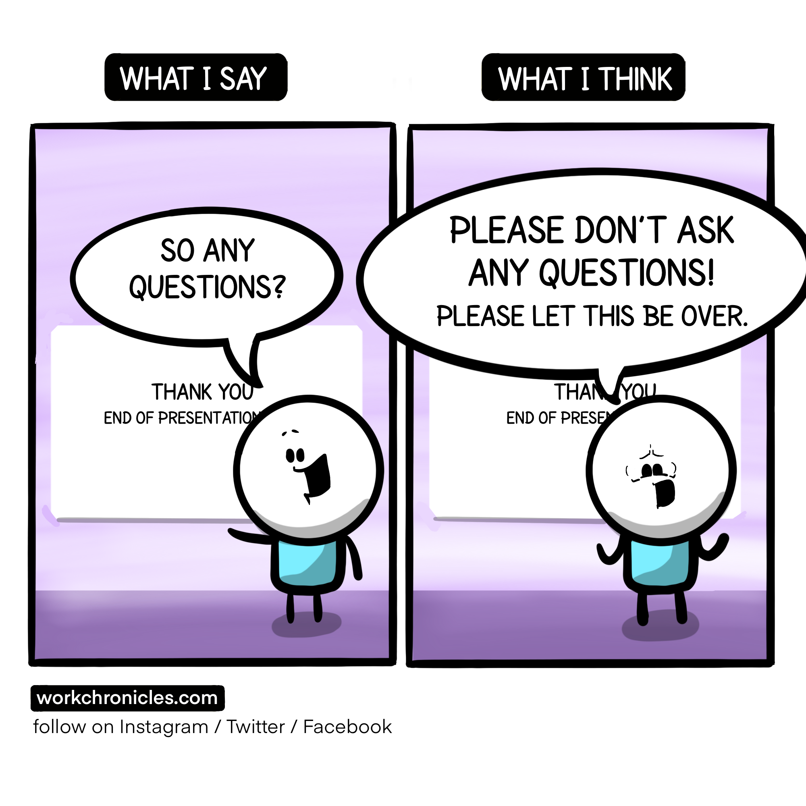

---

<style scoped>
p {
  color: #e4e2f5;
  text-align: right;
}
</style>

<style scoped>
h1 {
  font-family: "SFMono-Regular", Consolas, "Liberation Mono", Menlo, monospace;
  color: #00ff66; /* bright green */
  background: #000000;
  padding: 0.5rem 0.75rem;
  border: 1px solid #00ff66;
  border-radius: 0.25rem;
  display: inline-block;
  letter-spacing: 0.04em;
  font-size:1.9rem;
  text-shadow: 0 0 8px rgba(0, 255, 102, 0.5);
  box-shadow: inset 0 0 12px rgba(0, 255, 102, 0.1);
}
</style>

# >>> "Thanks for your attention!"  

# >>>  "Happy coding!"

&nbsp;
&nbsp;
&nbsp;
&nbsp;
&nbsp;

Pietro - @iz4vve
http://bit.ly/4dfU5lf

<!--  -->